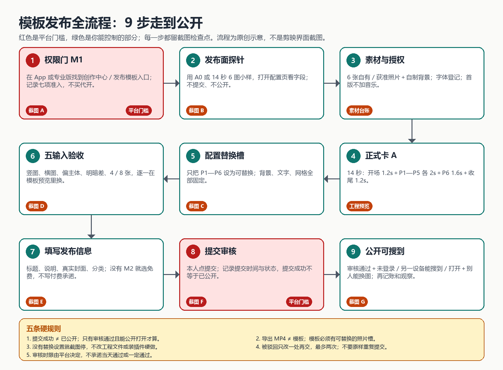
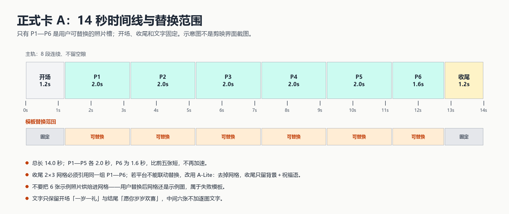
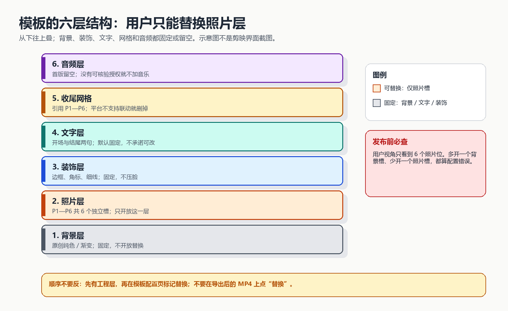
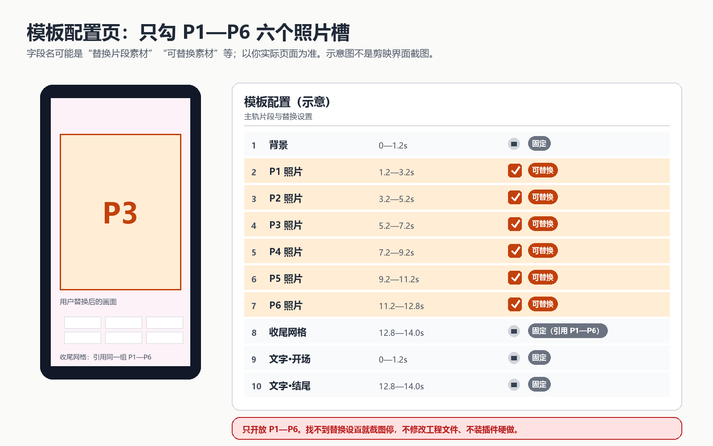
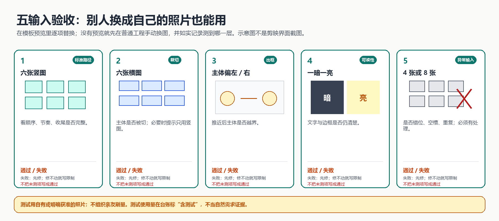
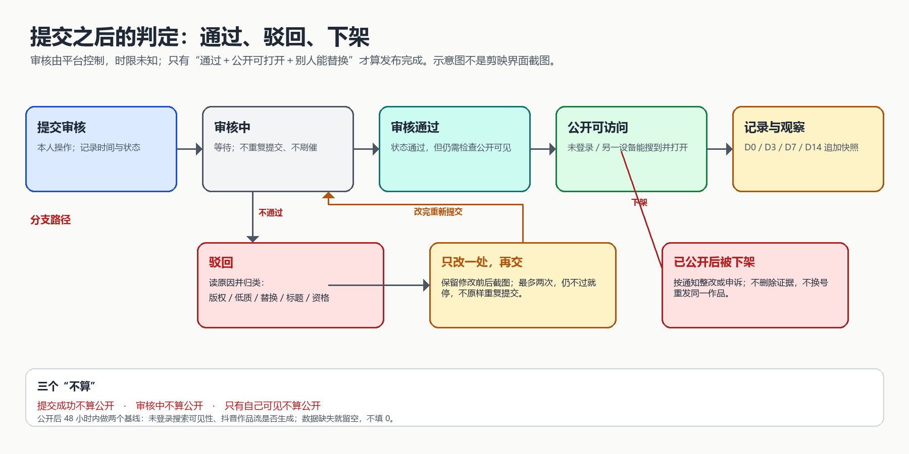

# 模板发布全流程：从工程到公开（图文步骤）

> 2026-10-29 初稿；2026-10-30 校准。适用：Windows 剪映＋国内剪映账号；目标：验证第一条原创照片模板的公开发布路径。
> 这是**待界面验证的发布参考**，不是已实测教程。A0练习见[一对一操作卡](今晚第一条_剪映Windows一对一操作_20261029.md)；候选设计与验收见[母版规格卡](母版规格卡_20261028.md)；经营、预算与止损见[执行手册](执行手册_从今天开始_20261028.md)。

**当前操作顺序（BOSS已确认）**：先打开Windows剪映首页／头像／个人主页，留一张模板或创作者入口截图；找不到就截图当前页，不猜按钮、不付款。核验实际申请条件、新手任务和收益资格后，再选一条最简单的原创模板验证发布。周岁／六图14秒保留为候选，不先堆复杂效果或批量制作；A0不是必须先做的关卡。AI工具须实际支持原生模板换素材与发布，普通AI成片不算。预算与D90目标不变。

**先把“保证”说清楚。** 本卡未在你的剪映里实测，不能保证流程完整、按钮存在或平台审核通过。下面的流程图和工序保留为10-29设计参考，不作为现行平台规则；先按截图核验，再使用适用分支。图中的搜索、免费字段、审核次数也不构成平台要求。

**使用时的校准规则**：找不到字段仅表示当前未确认，不足以断言账号或版本不支持；不默认存在免费选项或可自行定价；公开链接可访问与搜索收录分开检查；收尾固定的是结构，照片仍须联动替换；申请、重试次数及后续产量不以本稿建议新增硬限制。先保留工程，不为探针删除已有A0。素材和字体（包括默认字体）均须核实授权。

**边界**：实际按钮以你屏幕为准；看不到就按检查点发截图，不猜着点、不装插件、不改工程文件硬做。

---

## 0. 先看总图：9 步、3 个停止点



| 步 | 做什么 | 通过标志 | 留什么证据 |
|---|---|---|---|
| 1 | 过权限门 | 能看到创作者／发布模板入口，或明确知道怎么申请 | 截图 A |
| 2 | 发布面探针 | 打开发布配置页，看到替换素材、权限、预览字段 | 截图 B |
| 3 | 备素材与授权 | 6 张照片、背景、字体都有来源 | 素材台账 |
| 4 | 做正式卡 A | 14 秒工程能完整预览 | 工程＋样片 |
| 5 | 配置替换槽 | 只有 P1—P6 可替换，其他固定 | 截图 C |
| 6 | 五输入验收 | 五种输入都记录通过／失败／不适用 | 截图 D |
| 7 | 填写发布信息 | 标题、说明、封面、免费状态核对完 | 截图 E |
| 8 | 提交审核 | 本人提交，记下时间与状态 | 截图 F |
| 9 | 公开可搜到 | 审核通过＋未登录／另一设备能搜到＋别人能换图 | 截图 G |

**三个停止点，到了就停，不硬闯：**

1. **第 1 步没有发布入口**：先申请／问客服；没有入口就无法发布，写再多文档也不能替平台开权限。
2. **第 2 步发布页没有“替换素材”设置**：说明当前版本／账号不支持这条路径，截图停；不要改草稿 JSON 或装插件。
3. **第 8 步驳回两次仍不过**：停，按驳回原因重估设计或问官方客服；不要原样反复提交。

**第一条先发免费版。** 能发模板 ≠ 能发付费模板。M2 付费权限是另一道门，没拿到就选免费，不写“付费模板”，也不为了发布开会员。目标是先把“公开一条”跑通，收入是后一层。

**时间预算**：预检 20 分钟＋素材 30—40 分钟＋正式制作 120—180 分钟＋配置槽 20—30 分钟＋五输入 40—60 分钟＋发布信息与提交 30—40 分钟，合计约 **5 小时**，分 2—3 次做；等审核不计人工工时。单次超过 180 分钟就砍效果，不熬夜补。

---

## 1. 发布可行性预检（20—30 分钟，先做）

这一节的目的不是做模板，而是**在投入几小时前确认“发布这条路存在”**。做完再决定要不要做正式卡 A。

### 1.1 过权限门 M1

国内剪映常见路径是：App「我的」→「创作中心」→「成为模板创作人／模板创作者」；剪映专业版部分版本在首页或个人主页有「模板／发布模板」入口。两者都以你当前界面为准，不把旧教程当现行规则。

**要记下的七项**（与[执行手册步骤一](执行手册_从今天开始_20261028.md)同一张表，不重复造第二份）：

| 项 | 记录 |
|---|---|
| 剪映版本（手机／电脑，版本号） | |
| 有没有创作者／模板入口 | 有／没有／未确认 |
| 现在能不能发布模板 | 能／不能／不确定 |
| 有没有付费模板权限 M2 | 有／没有／不确定 |
| 付费权限的申请条件与入口 | |
| 规则说明截图 | 有／没有 |
| 创作者昵称（剪映＝抖音＝小红书＝闲鱼统一） | |

**三种状态，三种动作：**

| 实际状态 | 现在做什么 | 不做什么 |
|---|---|---|
| 已有发布权限 | 直接进入 1.2 发布面探针 | 不把“能发”当成“能发付费” |
| 有申请入口、尚未通过 | 按页面要求提交申请；最多准备 3 份申请样片 | 不买代开、不买“保过”、不先生产 50 条库存 |
| 没有入口／找不到 | App 内帮助与客服发工单；保留截图与时点 | 不猜按钮、不装插件、不换号碰运气 |

申请页要什么就交什么；申请用的样片 MP4 与“别人可替换的模板”不是同一个交付物。提交后记录时间、状态和官方通知，**没收到通过不能写“创作者已开通”**。工单文本直接用执行手册步骤一 B 的两张，不临时改写承诺。

### 1.2 发布面探针（10 分钟，不提交）

用已有的 A0 练习工程，或新建一个 **14 秒、6 张练习图**的小样，只为了打开发布页看字段：

1. 在小样工程里找「发布模板／创建模板／模板」入口；找不到就回首页、个人主页、导出按钮附近再看一圈。
2. 打开发布配置页，只看四件事：**模板类型、替换素材设置、权限／价格、预览入口**。
3. 看完直接退出／取消，**不点提交、不公开、不填真实价格**。这个小样不是正式作品，探针结束后删掉。

如果 14 秒、6 图的小样仍被格式校验拦住，截图提示并停：这说明发布面还没准备好，不是靠换素材或买会员就能猜过去的。

| 你看到什么 | 说明 | 下一步 |
|---|---|---|
| 四个字段都能看到 | 发布路径存在 | 进入第 2 节备素材 |
| 有发布页，但没有替换素材设置 | 当前版本／账号不支持可替换模板 | 截图停；问客服是否有其他入口或版本要求 |
| 只有“发布视频”，没有“发布模板” | 这是普通视频发布，不是模板 | 回 1.1 确认权限；不要拿 MP4 当模板 |
| 发布页强制付费或强制会员 | 免费路径不明 | 截图停；先查付费权限与免费发布条件，不付款试 |

**通过标志**：你亲眼看到“替换素材”与“预览”字段，并截图 B（遮住账号信息）。没看到就不进入正式制作。

### 1.3 决定在哪一端发布

| 路径 | 什么时候用 | 必须先验证 |
|---|---|---|
| 电脑专业版直接发布 | 专业版里能看到「发布模板」 | 配置页有替换素材字段 |
| 电脑工程同步到手机再发 | 官方云备份／草稿同步可用 | 先用 A0 小样验证同一账号能看到草稿；不默认一定可同步 |
| 手机重建后发布 | 电脑没有发布入口，同步也不可用 | 8 段＋2 条文字，按第 3 节时间表重搭；素材用数据线或本地传输，不传未知网盘 |
| 都不可用 | 发布面不存在 | 停；走客服／申请，不用私有接口硬做 |

私人照片（尤其孩子正脸）不要为了“同步方便”上传到不明网盘或第三方工具；能本地传就本地传，是否公开使用由你本人决定。

---

## 2. 素材与授权（30—40 分钟）

公开模板的演示图会出现在模板封面和预览里，**练习用的数字卡不能直接当公开版素材**——用户看不懂场景，也容易被判低质。正式版用下面这套：

| 素材 | 要求 | 记录到 |
|---|---|---|
| 6 张演示照片 | 自有或家人朋友**书面同意**；优先无清晰正脸、无住址／证件信息的照片；不要网图、明星图、别人家孩子 | `data/official_template_assets.csv` |
| 背景 1 张 | 自己做的纯色／渐变／简单几何；不用未授权网图 | 同上 |
| 边框／角标 | 自己绘制；不复刻竞品贴纸 | 同上 |
| 字体 | 先用剪映自带默认字体；如换字体，记录名称、来源、许可证 | 同上 |
| 音乐／音效 | **首版不加**；没有可核验的再分发授权就不放 | 同上 |

素材台账每行填：素材编号、类型、名称、作者或权利方、原始来源、取得日期、许可证、**是否允许付费模板再分发**、是否允许转授权、授权证据位置、使用限制、核验状态、关联作品编号。**“来源待补”不得发布。**

**隐私建议**：周岁场景可以用蛋糕、气球、小鞋、玩具、脚印、家人手部等不含正脸的照片做演示；如果坚持用孩子正脸，先确认你接受它出现在公开模板页，并且没有可识别的住址、姓名、生日等隐私信息。演示照片不需要上传给助手，保存在你自己的私密目录。

---

## 3. 做正式卡 A（120—180 分钟）

第一次做建议沿用 A0 的操作习惯；正式版与 A0 的差别只在时间点和收尾。规格以[母版规格卡](母版规格卡_20261028.md)为准，本节只讲怎么落地。

### 3.1 时间线：14 秒，8 段连续



| # | 主轨内容 | 开始 | 结束 | 本段时长 | 替换 |
|---|---|---:|---:|---:|---|
| 1 | 背景＋开场标题 | 0.0s | 1.2s | 1.2s | 固定 |
| 2 | P1 照片 | 1.2s | 3.2s | 2.0s | 可替换 |
| 3 | P2 照片 | 3.2s | 5.2s | 2.0s | 可替换 |
| 4 | P3 照片 | 5.2s | 7.2s | 2.0s | 可替换 |
| 5 | P4 照片 | 7.2s | 9.2s | 2.0s | 可替换 |
| 6 | P5 照片 | 9.2s | 11.2s | 2.0s | 可替换 |
| 7 | P6 照片 | 11.2s | 12.8s | 1.6s | 可替换 |
| 8 | 2×3 网格＋结尾祝福 | 12.8s | 14.0s | 1.2s | 固定（引用 P1—P6） |

P6 比前五张短，**不要加速**补时长；整条不因“看起来差不多”改成 15 秒或 13 秒。实际帧率导致差几帧时，记录实际值，不称“已按规格完成”。

### 3.2 六层结构：只让用户动照片层



从下往上搭：

1. **背景层**：原创纯色／渐变，铺满 9:16；固定，不开放替换。
2. **照片层**：P1—P6 六段独立素材，按上表排；每段只放一张图，不要合并成一张长图。
3. **装饰层**：圆角／细边框／角标；固定，不压脸、不挡字。
4. **文字层**：开场「一岁一礼」0—1.2 秒；结尾「愿你岁岁欢喜」12.8—14.0 秒；中间六张**不加**逐图文字。
5. **收尾层**：2×3 网格复用同一组 P1—P6；顺序与前面一致。
6. **音频层**：首版留空；没有可核验授权就不加音乐。

动效只用轻微推近／淡化／轻推；不做旋转、闪白、快切卡点。**先保证替换稳定，再谈好看**；任何动效导致换图后出框、错位或黑帧，就删掉该动效并记录。

### 3.3 收尾网格的关键限制

收尾网格必须**引用同一组 P1—P6**，不能把 6 张示例照片“烘焙”进去。否则用户换完照片，正片是自己的，结尾网格还是你的示例图——这是失败模板。

发布前在配置页确认：网格里的 6 个位置是否跟随 P1—P6 替换。**如果平台不支持联动**，不要硬做网格；直接进入下面的 A-Lite。

### 3.4 降级版 A-Lite：为了能发布，不为了偷懒

出现以下任一情况，降到 A-Lite，并在作品台账／备注写清版本与原因：

- 平台不能把收尾网格联动到 P1—P6；
- 加上推近／网格后，替换测试出现出框、错位、黑帧，短时间修不好；
- 当前设备性能导致预览/导出反复失败。

**A-Lite 的改法**：保留 14 秒、6 个照片槽、开场 1.2 秒、结尾 1.2 秒；去掉 2×3 网格，结尾改为纯背景＋「愿你岁岁欢喜」；必要时去掉推近动效，只做硬切／淡化。**A-Lite 仍是可发布模板，但不是完整卡 A**，不能对外写“六宫格收尾”或“完整卡A已验收”。

### 3.5 保存、重开、导出样片

1. 保存工程，回首页重新打开：素材不丢、时间线还在，才算工程成立。
2. **不要移动或删除素材文件夹**；工程可能引用原路径。
3. 导出一条本地 MP4 预览（1080p、30fps，若可选）；从头播到尾，检查黑帧、顺序、文字。
4. **MP4 只是预览，不是模板**；模板必须在发布页配置替换槽后才成立。

---

## 4. 配置替换槽（20—30 分钟，最关键的一步）



进入发布／模板配置页后，按这个顺序做：

1. 选择“模板”类型（不是普通视频），选中刚才的工程。
2. 找到「替换片段素材／可替换素材／替换设置」这类字段。
3. **只勾 P1—P6 六段照片**；背景、开场、结尾、文字、网格全部保持固定。
4. 如果页面把“文字”也列为可替换，**先不要勾**——文字替换能力未验证，第一条只开放照片，避免用户改字后溢出。
5. 权限／价格：没有 M2 就选免费；不填付费价格、不写“付费模板”。
6. 找「预览／模拟用户／替换测试」：用另一张图替换 P3，确认仍为 5.2—7.2 秒、前后片段不移位、文字不变。

| 常见错误 | 后果 | 改法 |
|---|---|---|
| 把背景也勾成可替换 | 用户能换掉你的版式，模板散架 | 取消背景勾选，只留 P1—P6 |
| 只勾了 5 个照片段 | 用户少一个槽，正片缺图 | 按时间表逐一核对 6 段 |
| 把 6 张图合并成一段 | 只能换一整组，不是 6 个独立槽 | 拆回 6 段独立素材 |
| 勾了文字槽但没测长短文字 | 用户输入长句溢出／遮挡 | 第一条不开放文字，固定文案 |
| 收尾网格烘焙了示例图 | 用户换图后结尾还是示例 | 改 A-Lite，删网格 |

**看不到替换设置就停**：截图当前完整页面，发出来确认；不要改草稿 JSON、不要装插件、不要用“把素材拖上去试试”猜一个可能不保留时长的动作。

**配置完成标志**：你以用户视角预览，只能看到 6 个照片位；背景、文字、结构都不可动；替换 P3 后时间与文字仍正确。截图 C。

---

## 5. 五输入验收（40—60 分钟）



**验收要在“模板预览／替换测试”里做**，不是在普通工程里拖图片。普通工程只能证明你会剪辑；模板预览才能证明用户换图后仍成立。如果当前页面没有预览，先记录“模板层未测”，不要写“五输入通过”。**没有模板预览就不要提交公开版**：先回普通工程验证，再问客服确认预览方式；把未测模板直接发出去，等于让用户替你测试。

| # | 输入 | 看什么 | 通过标准 | 失败怎么办 |
|---|---|---|---|---|
| 1 | 6 张清晰竖图 | 顺序、节奏、收尾 | 无黑帧、无错位、末帧完整 | 修时间线／槽位后重测 |
| 2 | 6 张横图 | 裁切是否切掉主体 | 主体保留；否则说明“建议竖图” | 调照片框／缩小推近；改说明 |
| 3 | 主体偏左／偏右 | 推近后是否出框 | 主体不越界 | 减推近幅度或改布局 |
| 4 | 一暗一亮 | 文字、边框是否可读 | 文字始终清楚 | 加深色底／改文字颜色／减装饰 |
| 5 | 4 张或 8 张 | 错位、空槽、重复 | 有明确处理：拒绝、循环或提示 | 平台固定 6 槽时记“不适用”并写限制，不算通过 |

**关于第 5 项**：如果平台强制 6 个槽，用户根本无法选 4 或 8 张，这一项是“不适用”，不是“通过”。在记录里写“平台固定 6 槽，无法输入 4／8；说明中已写需 6 张”，并保留截图。

**“另一个人”测试**：规格要求用另一个人的照片替换后仍正常。找一位愿意帮忙的家人朋友，用其**明确授权**的照片做一次替换预览；不要为了测试注册小号、不要刷量、不要给返利。做不到就如实写“仅本人照片测试”，不要把本人测试当自然需求证据。

**任何一项失败**：先修；修不动就把限制写进模板说明（例如“请使用 6 张竖图”），再重测受影响项。**不把未测项写成通过**。截图 D 至少包含：替换后的预览、时间线、失败项记录。

---

## 6. 填写发布信息（20 分钟）

| 字段 | 第一条建议 | 注意 |
|---|---|---|
| 标题 | `周岁成长回顾｜上传 6 张照片` | 不写“免费”“官方认证”“保证出片”“永久有效” |
| 说明 | 准备 6 张清晰照片，套用后生成约 14 秒周岁成长短片；建议竖图；中间无逐图文字，结尾为固定祝福 | 与实物一致；A-Lite 就删掉“网格”描述 |
| 封面 | 从实际成片截一帧（建议 P1 或结尾祝福） | 不用 AI 概念图冒充最终效果 |
| 分类／标签 | 亲子／生日／纪念中最接近的；标签 3—5 个，如周岁、成长记录、照片模板、生日纪念 | 不堆无关热词 |
| AI 标注 | 背景／图形若由 AI 生成，按平台要求标注；全自制就写原创 | 不把“程序绘制”说成“AI 生成”或反之 |
| 付费状态 | 免费（未取得 M2 时） | 不设价格、不写“付费模板” |
| 可见性 | 公开 | 不选“仅自己可见”后又说已发布 |

**发布文案里绝不出现**：外链、微信、二维码、网盘、私人联系方式；“加我送模板”“关注后私信”；“平台内部渠道”“代开”“保过”。这些既容易违规，也会把模板页变成导流页。

填写完先截图 E（整页，遮账号信息），再提交。**你本人点提交，助手不代发。**

---

## 7. 提交审核与驳回循环（20 分钟＋等待）



提交后记录：提交时间、模板标题、状态、页面提示。审核时限由平台决定，**不承诺当天通过**；等待期间不重复提交、不刷催、不换号重发。

| 状态 | 含义 | 动作 |
|---|---|---|
| 审核中 | 平台还没给结果 | 等；可以准备下一条素材，但不批量生产 |
| 审核通过 | 平台通过，但未必公开可见 | 去未登录／另一设备搜一次，确认能打开 |
| 驳回 | 未通过 | 读原因，归类后只改一处，再交 |
| 已公开后被下架 | 发布后违规或投诉 | 按通知整改或申诉；不删证据、不换号重发同一作品 |

**驳回归因表：**

| 驳回原因 | 只改什么 | 重测什么 |
|---|---|---|
| 素材版权／低质 | 换素材、提高清晰度、删装饰 | 五输入中受影响项＋全片预览 |
| 替换失败／槽位错误 | 重新只勾 P1—P6，修时间线 | 6 个槽逐一替换 |
| 标题夸张／诱导 | 改标题与说明，删“保证／免费／官方” | 文案逐条核对 |
| 付费资格不符 | 改免费发布 | 权限状态截图 |
| 封面／分类不符 | 换真实封面、改分类 | 预览页显示 |

**最多两次**。两次仍不过就停：把驳回原文、修改前后截图、当前配置发出来，重估是设计问题、素材问题还是账号权限问题；不要原样第三次提交。

**只有同时满足这三条，才算“发布完成”**：

1. 审核状态为通过；
2. 未登录或另一台设备能搜到并打开；
3. 用另一人的照片替换后，6 个槽、时间线、文字仍正常。

“提交成功”“审核中”“只有自己可见”都不算公开。截图 F／G。

---

## 8. 公开后 48 小时与 D3／D7／D14

### 8.1 两个基线（10 分钟）

1. **可搜到性**：用未登录状态或另一台手机搜「周岁模板」「成长相册」「周岁视频」，记录能否搜到、大致位置；搜不到先改一次标题／标签，等 48 小时再看，不连续改。
2. **抖音作品流**：确认发布模板是否自动生成抖音作品；若有，记录播放量基线。看不到就留空，不填 0。

### 8.2 观察快照

公开当日为第 0 天，之后第 3／7／14 天追加到[观察快照](data/official_template_observations.csv)：作品编号、带时区观察时间、首次公开日、抖音作品链接、累计使用量、累计播放量、测试流量标记、数据完整性、来源证据、备注。**只追加，不覆盖旧值；缺失留空；显示“万”级取整时在备注写原值及约数性质。**

### 8.3 数据低时怎么归因

| 现象 | 归因 | 只做什么 |
|---|---|---|
| 抖音有播放、模板使用低 | 模板吸引力／场景匹配问题 | 只改一次封面／标题／场景，观察 48 小时 |
| 抖音无播放 | 分发／冷启动问题 | 查发布设置与标签，不怪场景 |
| 剪映搜不到 | listing 问题 | 改标题／标签一次，等 48 小时 |
| 使用量低但数据不完整 | 不能归因 | 补数据，不拍脑袋改方向 |

单条 14 天只归因，不单条杀线；阶段判断看组合级（执行手册 15.3）。**使用量 ≠ 付费人数 ≠ 作者收入。**

### 8.4 记账

- 审核通过并公开后，才在[作品台账](data/official_template_register.csv)建行：作品编号、母版编号、标题、公开日、链接、版本、付费状态、素材引用、制作分钟、质检结果。
- 当天在[每日台账](data/official_template_daily.csv)记工时、支出、平台收益；没有就留空写“未产生”，不填虚构数字。
- 平台收益、套装收入、固定成本覆盖分开记；提现不重复记收入。口径见[总账](../../cockpit/ledger.md)。

---

## 9. 收工判定与下一步

### 9.1 第一条“做完了”的清单

- [ ] 审核通过，未登录或另一设备能搜到／打开。
- [ ] 用户视角只有 P1—P6 六个照片槽；背景、文字、结构固定。
- [ ] 五输入有完整记录；失败项已修或写明限制；未测项标“不适用／未测”。
- [ ] 用另一人的授权照片替换后仍正常（至少一次）。
- [ ] 素材台账、作品台账、每日台账已登记；实际耗时是记录值，不是估算。
- [ ] 没有购买、没有付费承诺、没有对外说“保证出片”。

### 9.2 卡住时

- **没有权限／入口**：停在[行动回执](../../cockpit/actions.csv)的 `JY-ACCESS`（到期 2026-11-09）；到期仍无入口，暂停制作增量，别一边等一边堆库存。
- **有入口但发布页没有替换设置**：截图问客服；不要换号、不要装插件、不要改工程文件。
- **审核两次不过**：停，按驳回原因重估；必要时把规格降到 A-Lite 或换更简单的场景。
- **第一条 30 天累计超过 10 小时仍未成**：砍效果再试一次；再败就停，不无限投入。

### 9.3 公开之后

第一条按既有D3／D7／D14窗口记录数据；第二条安排仍以执行手册及BOSS决定为准，本稿不另设“必须等满14天”或每周条数。第二条须检验能否复用结构并减少手工劳动，不因首件公开就批量复制凑数。

**不要**因为第一条公开了，就立刻上套装、开付费、做 30 条库存；套装还卡在 G1 与定价（L3），付费还卡在 M2。

---

## 10. 截图清单与回报模板

| 编号 | 什么时候截 | 截什么 | 发给谁 |
|---|---|---|---|
| A | 权限门 | 创作者／模板入口、申请要求（遮账号） | 自己留存；需要时发助手 |
| B | 发布面探针 | 发布配置页四个字段 | 助手核对路径 |
| C | 配置替换槽 | 只有 P1—P6 可替换的页面 | 助手核对槽位 |
| D | 五输入 | 替换后预览、时间线、失败项 | 助手判是否通过 |
| E | 发布信息 | 标题、说明、封面、免费状态 | 提交前自查 |
| F | 提交审核 | 提交成功页／状态页（遮账号） | 自己留存 |
| G | 公开后 | 未登录搜索结果＋公开页＋替换成功 | 助手记账 |

截图存本地私密目录；**不要提交含账号、手机号、身份证、Cookie、买家信息的原图到 git**。需要发助手时先遮挡。

做完发这一段即可：

```
现在到：预检 / 素材 / 正式A / 配置槽 / 五输入 / 发布信息 / 已提交 / 已公开 / 卡住
剪映版本与端：Windows / 手机，版本____
权限：有发布入口 / 能申请 / 没有 / 未确认
付费权限 M2：有 / 没有 / 未确认
模板状态：未提交 / 审核中 / 通过 / 驳回 / 已公开 / 下架
六槽：能独立替换 / 不能 / 未测
五输入：通过__项，失败__项，不适用__项
实际耗时：____分钟
卡住的页面或按钮：
下一步想做什么：
```

---

## 11. 依据与未验证边界

**有依据的部分**：

- [《剪映创作者服务协议》](https://lf9-cdn-tos.draftstatic.com/obj/ies-hotsoon-draft/vco/6c71ed75-25d1-4003-8a3c-0de1d8fbab73.html)公开页面标注更新于2024-12-02，2026-10-30复核：4.2—4.4区分创作者、作品及付费资格审核；4.5售卖方式与价格由平台制定；5.1.3优质免费作品可能获得平台激励。不能据此确认2026年全部活动细则或本账号资格。
- [2026-09-21新华网报道](https://www.xinhuanet.com/tech/20260921/6742f6c1f32f41d4918105bc686fe907/c.html)提到模板作者AI助手和升级新手任务；这是功能发布线索，不是本账号可用、免费或可获收益的证明。
- 本轮未找到适用于本账号的完整申请门槛与审核时限；不将“未找到”写成平台从未公开，不承诺“几天必过”“多少条必过”。历史证据索引以实际已收录条目为准，不声称隐私政策全文及哈希已经存入该索引。

**还没验证的部分**：

- 你的账号是否有创作者入口、是否能发模板、是否有 M2；当前均为未确认。
- 你的剪映版本里“发布模板”“替换片段素材”“预览”的确切名称与位置；本卡的候选路径必须用截图核对。
- 电脑工程能否同步到手机、是否必须手机发布；先用现有小样核验并保留工程，不默认可行。
- 新手任务、AI作者助手的入口、适用范围、费用与生成结果；普通AI成片不等于可替换的原生模板。
- 平台审核实际时长、通过率、付费单价与结算；没有替你提交或发布。
- 本卡没有产生真实模板、没有收入、没有成交；所有“通过标志”都要本人操作后才能打勾。

**最后一句**：本卡是待验证的设计参考，不保证流程完整或审核通过；当前先核实真实入口，缺证据就记录缺口，不继续批量投入。
